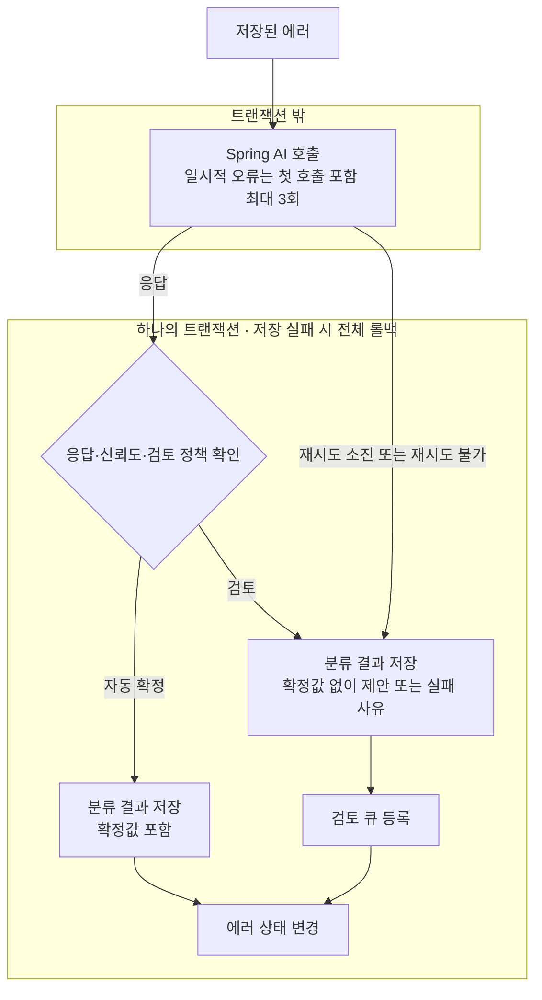

# AI Classification Fallback

AI로 에러를 분류할 때, 불확실한 응답을 그대로 확정하거나 API 호출에 실패한 에러를 놓칠 수 있다.

응답의 유효성과 신뢰도를 확인해 자동 확정과 검토 대상을 나누고, 재시도 후에도 호출이 실패하면 검토 큐에 남기도록 했다. 분류 결과 저장과 검토 큐 등록, 에러 상태 변경은 하나의 트랜잭션으로 묶어 일부만 저장되는 상황을 막았다.

## 기술 스택

| 구분 | 기술 |
| --- | --- |
| 언어 · 프레임워크 | Java 17, Spring Boot 4.1.1 |
| AI 연동 | Spring AI 2.0.1, OpenAI |
| 데이터 저장 | Spring JDBC (`JdbcClient`), H2 |
| 모니터링 | Spring Boot Actuator, Micrometer |
| 테스트 | JUnit 5, Mockito |
| 빌드 · 코드 작성 | Gradle, Lombok |

## 테이블 구성

| 테이블 | 역할 | 주요 컬럼 |
| --- | --- | --- |
| `errors` | 분류할 에러와 현재 처리 상태 | `message`, `state` |
| `classification_result` | AI 응답과 확정된 분류 | `proposed_label`, `confidence`, `confirmed_label`, `failure_reason` |
| `review_queue` | 검토가 필요한 에러와 사유 | `error_id`, `reason`, `state` |

AI의 제안이 확정된 분류로 취급되지 않도록 `proposed_label`과 `confirmed_label`을 나눴다. 검토 대상은 제안만 남기고 확정값을 비워둔다. 호출에 실패해 응답이 없으면 실패 사유를 남긴다.

## 처리 흐름

## 처리 방식

AI 응답에는 정의하지 않은 분류값이나 범위를 벗어난 신뢰도가 들어올 수 있다. 먼저 응답을 검증하고, 유효한 응답에만 신뢰도 임계값을 적용한다. 불확실하거나 유효하지 않은 결과는 확정하지 않고 검토 대상으로 남긴다.

| 상황 | 처리 |
| --- | --- |
| 유효한 응답이고 신뢰도가 임계값 이상 | 자동 확정 |
| 낮은 신뢰도 또는 유효하지 않은 응답 | 검토 큐에 등록 |
| 일시적 API 오류 | 첫 호출 포함 총 3회 시도, 소진되면 검토 큐에 등록 |
| 인증 오류 등 재시도할 수 없는 오류 | 재시도 없이 검토 큐에 등록 |

일시적인 API 오류는 다시 호출하면 성공할 수 있어 재시도한다. 다만 계속 실패하는 요청을 반복하지 않도록 첫 호출을 포함해 총 3회로 제한했다. 인증 오류처럼 같은 요청을 반복해도 해결되지 않는 오류는 바로 검토 대상으로 남긴다.

외부 API 응답을 기다리는 동안 DB 트랜잭션을 유지하지 않도록 AI 호출은 트랜잭션 밖에서 수행한다. AI 호출이 끝난 뒤의 결과 저장·검토 큐 등록·에러 상태 변경은 `@Transactional`로 묶었다. 큐 등록에 실패하면 결과 저장도 롤백하고, 에러는 처리 전 상태로 남긴다.

검토 대상이 쌓이는지 확인할 수 있도록 Actuator의 `review.queue.pending` 메트릭에 검토 대기 건수를 노출했다.

신뢰도는 모델의 자기 평가라 높아도 틀릴 수 있다. 임계값으로 모든 오답을 걸러낼 수는 없으므로, 자동 확정 없이 전체 결과를 검토하는 정책도 두었다.

## 검증

[WorkflowTest](src/test/java/dev/dojo/fallback/integration/WorkflowTest.java)에서 Mockito와 로컬 HTTP 서버로 응답과 오류를 재현하고, DB에 남은 결과와 실제 호출 횟수를 확인한다. 서버를 따로 실행하거나 API 키를 설정할 필요 없이 JUnit으로 확인할 수 있다.

| 재현한 상황 | 확인하는 결과 |
| --- | --- |
| 낮은 신뢰도, 유효하지 않은 분류값·신뢰도 | 자동 확정하지 않고 검토 대상으로 저장 |
| 503 응답 두 번 후 정상 응답 | 총 3회 호출 후 분류 결과 확정 |
| 일시적 오류가 3회 연속 발생 | 재시도 소진 사유를 남기고 검토 큐에 등록 |
| 401 인증 오류 | 한 번만 호출하고 검토 큐에 등록 |
| 비동기 처리 중 검토 큐 저장 실패 | 분류 결과와 큐 항목이 남지 않고 에러 상태도 변경되지 않음 |

전체 검토 정책에서 높은 신뢰도의 응답도 확정되지 않는지, 비동기 호출에도 재시도가 적용되는지, 검토 대기 건수가 메트릭에 반영되는지도 확인한다.

임계값을 높이면 자동 확정 대상이 줄고 검토 대상이 늘어난다. 자동 확정 오답과 검토 부담을 함께 비교하기 위해 [ClassificationPolicyExperiment](src/test/java/dev/dojo/fallback/experiment/ClassificationPolicyExperiment.java)를 작성했다. 정답을 붙인 에러 50건을 실제 모델로 분류한 뒤, 같은 응답에 임계값 `0.5·0.7·0.9`를 적용해 신뢰도 구간별 일치율, 자동 확정 오답률, 검토 전환율을 기록한다.

실제 모델 측정 결과는 아직 기록하지 않았다. 실행 후 결과는 `reports/classification-policy.md`에 생성된다.
